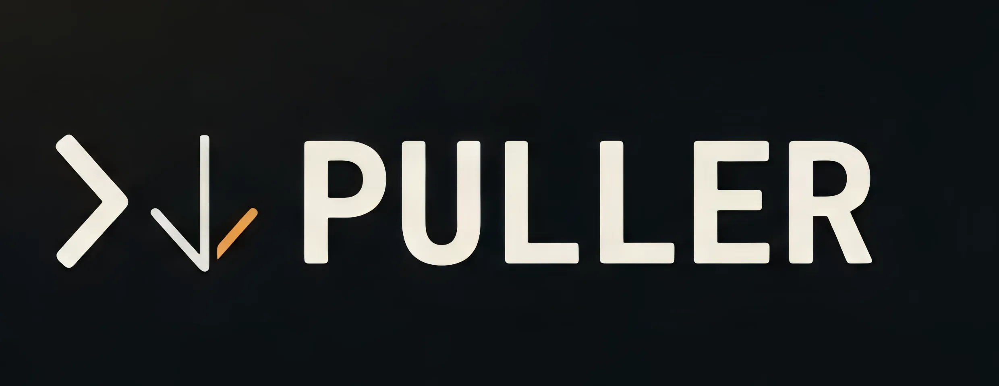
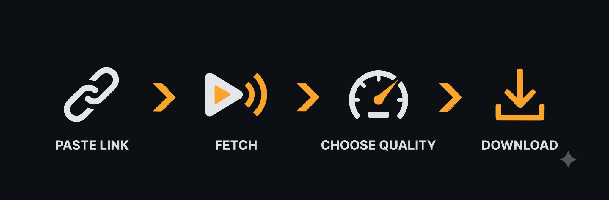

<div align="center">
  
</div>

# Puller — a yt-dlp powered YouTube downloader

A web app that can run locally or be self-deployed: paste a YouTube URL, pick video or audio, pick a quality, download. Backend is FastAPI + yt-dlp; frontend is one plain HTML file (no build step). Everything below is command-only so it matches the actual repo contents.



## Table of Contents

- [Requirements](#requirements)
- [Manual setup](#manual-setup)
- [Everyday use](#everyday-use)
- [Features](#features)
- [Optional commands](#optional-commands)
- [Deployment](#deployment)
- [Notes & limitations](#notes--limitations)
- [Developer Info](#developer-info)
- [File layout](#file-layout)

## Requirements

- **Python 3.11+**
- **ffmpeg** on your PATH — needed to merge video+audio streams and to transcode audio to a target bitrate.
  - macOS: `brew install ffmpeg`
  - Windows: `winget install ffmpeg`
  - Linux: `sudo apt install ffmpeg` (Debian/Ubuntu) or your distro's equivalent
- **JavaScript runtime** _(only when running outside Docker)_ — needed by yt-dlp for YouTube extraction: **Deno ≥ 2.3.0** (recommended) or **Node ≥ 22**.

Check both are visible to your terminal:

```bash
python3 --version
ffmpeg -version
```

_(Windows: use `python --version` instead of `python3`.)_

---

## Manual setup

If you prefer to set up everything manually, follow these steps inside the `puller/` folder:

### Step 1 — Create a new virtual environment

Creates an isolated Python environment in `.venv/` so dependencies do not clash with your machine.

**Windows (PowerShell)**

```powershell
python -m venv .venv
```

### Step 2 — Activate it and install requirements

**Windows (PowerShell)**

```powershell
.venv\Scripts\Activate.ps1
pip install -r requirements.txt
```

### Step 3 — Start the server

With the virtual environment activated:

```powershell
python -m uvicorn main:app --host 127.0.0.1 --port 8000
```

Open **http://127.0.0.1:8000** in your browser. To stop the server: `Ctrl+C` in the terminal.

---

## Everyday use

You only need to install dependencies once. Every time after that, just activate the environment and start the server:

**macOS / Linux**

```bash
source .venv/bin/activate
uvicorn main:app --host 127.0.0.1 --port 8000
```

---

## Features

- **Single video download:** Choose between Video (up to 1080p, configurable via `MAX_HEIGHT`) or Audio only (48, 128, 256, 320 kbps). Custom filenames are fully supported.
- **Playlist cap:** The number of items fetched from a playlist is capped and configurable via `MAX_PLAYLIST_ITEMS`.
- **Playlist support:** Paste a playlist URL to automatically probe and list all videos. You can download individual videos row-by-row, or click "Download all (.zip)" to batch download the entire playlist into a single `.zip` file.
- **Live progress indicators:** The UI polls the backend API to display real-time ETA and status text. An animated SVG spinner is shown during processing and seamlessly morphs into a checkmark upon completion.
- **Instant cancellation:** Active downloads can be interrupted at any time using the "Cancel" button. This works for single videos, individual playlist rows, and batch zip jobs. Cancelling automatically cleans up any partially downloaded temporary files.

---

## Optional commands

**Make the app reachable from other devices on your home network:**

```bash
uvicorn main:app --host 0.0.0.0 --port 8000
```

Then visit `http://<your-computer's-LAN-IP>:8000` from another device on the same Wi-Fi/network.

**Update yt-dlp** (run this whenever downloads start failing — YouTube changes things often):

```bash
pip install -U "yt-dlp[default]"
```

_(Run this with the virtual environment activated.)_

**Update all dependencies to what's pinned in requirements.txt:**

```bash
pip install -r requirements.txt --upgrade
```

---

## Deployment

Puller ships a `Dockerfile` — the recommended way to run it anywhere.

### Docker (local)

```bash
docker build -t puller .
docker run -p 8000:8000 puller
```

Open **http://localhost:8000**.

### Render (one-click)

1. Push the repo to GitHub.
2. In [Render](https://render.com), create a new **Web Service** → connect the repo → set **Runtime** to _Docker_.
3. Set the environment variables below and deploy. Render injects `$PORT` automatically.

> **Note:** Static providers (GitHub Pages, Vercel, Netlify) will **not** work — Puller needs background threads, ffmpeg binaries, and writable temp storage.

### Environment variables

| Variable             | Default | Meaning                                                           |
| -------------------- | ------- | ----------------------------------------------------------------- |
| `PORT`               | `8000`  | Port the server listens on (injected by Render/Fly automatically) |
| `MAX_HEIGHT`         | `1080`  | Maximum video height in pixels (e.g. `720`, `1080`)               |
| `MAX_PLAYLIST_ITEMS` | `50`    | Maximum number of playlist entries fetched per request            |

---

## Notes & limitations

- **Personal and self-hosted use.** Puller can run locally or be self-deployed — downloading video is still subject to YouTube's Terms of Service and copyright law in your country; that's on you to respect.
- **High-resolution downloads are slow and large.** At the default 1080p cap that's real muxing work from ffmpeg, not a bug. Raise `MAX_HEIGHT` only if your server can handle the extra load.
- **Custom filenames are sanitized.** If you enter a custom name, invalid path characters will automatically be stripped before saving.

---

## Developer Info

- Name: Chirantan Mallick
- GitHub: [SpicychieF05](https://github.com/spicychief05)
- LinkedIn: [Chirantan Mallick](https://www.linkedin.com/in/c-mallick/)
- Tableau: [Chirantan Mallick vizzes](https://public.tableau.com/app/profile/chirantan.mallick/vizzes)

---

## File layout

```
ytdlp-downloader/
├── main.py            # FastAPI backend (yt-dlp glue)
├── requirements.txt   # Python dependencies
├── Dockerfile         # container image for deployment
├── .dockerignore      # files excluded from Docker build context
├── .gitignore         # files excluded from version control
├── static/
│   └── index.html     # the entire frontend
├── media/             # logo and SVG assets
└── README.md
```
